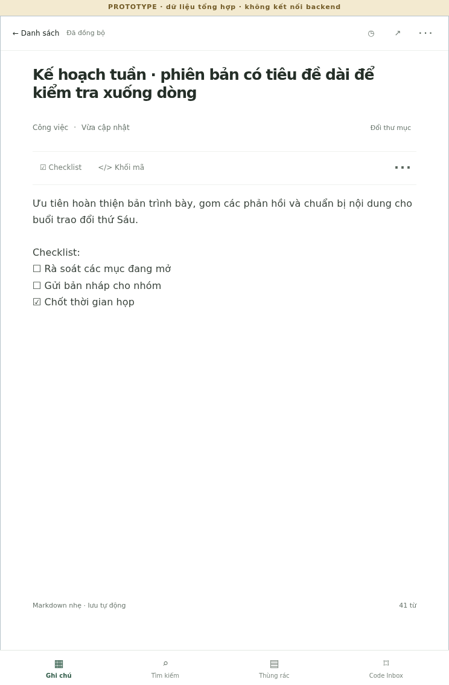
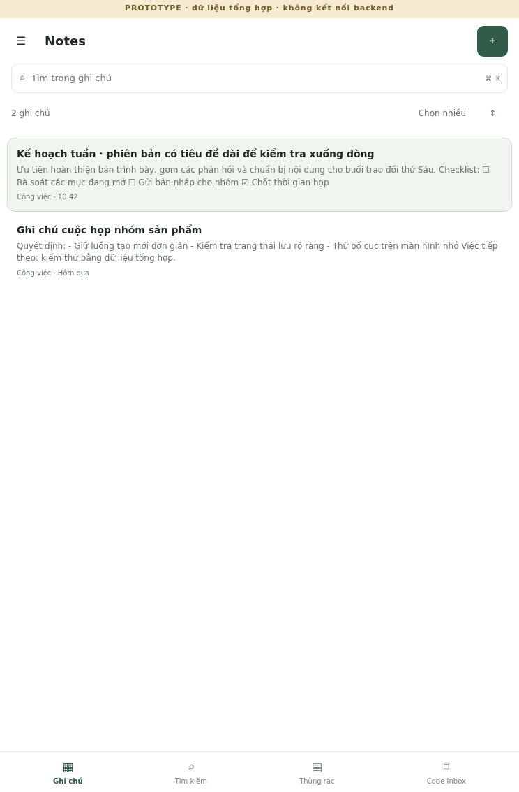

# Notes responsive UI prototype — 2026-10-29

## Scope and safety

This is a review prototype on branch `codex/ui-responsive-prototype-20261029`, based on canonical `main` commit `585e7a7a99f88c4dbf7df78818f6860b41884411` (tree `7019c1cc7c67755a79fe5c15c866db4780a99be4`). It does not change the Firestore application, API, authentication/session, schema, or Production deployment. `prototype/ui-responsive/` is static and has no API calls. It stores synthetic edits only under `web-notes-ui-prototype-synthetic-v1` in the browser's localStorage.

The baseline screenshots are a synthetic reconstruction using the current `public/app.css` and the current page structure, with fixture content in place of any account data. They are not screenshots of an authenticated Production session. Both baseline and prototype images contain only synthetic text.

## Baseline observations

- The current page uses a 225px folder column and a note-card grid; the editor follows below the list at tablet and desktop widths. It does not provide a persistent list/editor split.
- Below 700px the source stacks the folder/search, list, and editor in one long page. Opening a note requires scrolling down to the editor; returning to the list has no dedicated mobile navigation surface.
- Square cards reserve substantial vertical area for each short preview. Folder controls, selection controls, and editor actions create long scroll regions on narrow screens.
- The outer source layout caps at 1240px. On wider PC viewports, it leaves unused horizontal space while keeping the editor below the list.
- Search, folder selection, bulk move/trash, restore, history, sharing/revocation, drafts, and Code Inbox are present in the source. These features must keep their existing semantics when the real application is later adapted.

Baseline screenshots at the same synthetic fixture and CSS viewport sizes:

| Viewport | Before |
| --- | --- |
| Phone, 390×844 |  |
| iPad mini reference portrait, 744×1133 |  |
| iPad mini reference landscape, 1133×744 |  |
| PC, 1440×900 |  |

## Prototype layout

- **Phone (≤700 CSS px):** one primary surface. The list and editor have explicit navigation; folders open in a drawer; a bottom navigation bar provides Notes, Search, Trash, and Code Inbox. The editor reserves space above the bottom bar and updates its inset from `visualViewport` when the viewport changes. Title and body remain the same DOM controls during resize so draft text and caret do not jump.
- **iPad mini portrait (744×1133 reference):** compare both variants using the same note fixture. Two-pane mode has a compact 64px folder rail, 290px list, 390px editor, and 310px editable body width. One-pane mode switches list/editor with folders in a drawer; editor is 744px wide with a 638px editable body. The wider editing surface helps long prose and code; the split view keeps note browsing visible. The prototype keeps both for review rather than deciding device preference from width alone.
- **iPad mini landscape (1133×744 reference):** full 232px folder sidebar, 340px list, 561px editor.
- **PC (1440×900 tested, intended through 1920 CSS px):** full folder sidebar, fixed-width list, flexible editor. The editable text column is constrained by the editor content max-width plus side padding; code uses the full text area.

Common behaviors include a growing title field, search, note creation, folder movement, multi-select, trash/restore, history panel, sharing/revocation labels, checklist/code insertion, Code Inbox entry, and scenario controls for loading, empty, offline/draft-held, sync error, and conflict. Actions in this prototype are local demonstrations and do not implement production Firestore semantics.

Touch targets were checked at 40 CSS px or larger for visible buttons. Keyboard focus uses a visible outline; Ctrl/Cmd+K focuses search; Escape closes the folder drawer or returns to the list. Reduced-motion settings disable transitions. Selected muted text was darkened; the principal small-text color `#68746b` has a 4.88:1 contrast ratio against white. This is a targeted check, not a complete accessibility certification.

Prototype screenshots:

| Viewport | After |
| --- | --- |
| Phone list, 390×844 |  |
| Phone editor, 390×844 |  |
| Phone conflict fixture |  |
| Phone empty fixture |  |
| iPad mini reference portrait, 744×1133, list + editor (390px pane / 310px body) |  |
| iPad mini reference portrait, 744×1133, one-pane editor (744px pane / 638px body) |  |
| iPad mini reference portrait, 744×1133, one-pane list |  |
| iPad mini reference landscape, 1133×744 |  |
| PC, 1440×900 |  |

## Browser and source checks

Chromium headless ran the prototype at 390×844, 744×1133, 1133×744, and 1440×900. All four had no horizontal overflow; visible controls met the 40px check; the long title did not clip. The interaction smoke covered search/open, editing, local synthetic draft after reload, history, share/revoke, creation, resize with text and caret retained, keyboard search, drawer open, multi-select, trash/restore, empty/conflict states, focus indicator, and reduced motion. Per-viewport dimensions, text-area widths, and checks are in `ui-prototype-20261029/browser-results.json`; the runner is `scripts/ui-prototype-smoke.mjs`. At the 744×1133 CSS reference, measured body width is 310px in split mode versus 638px in one-pane mode; panel widths are 390px versus 744px.

- `npm run check:source` — PASS; 49 JavaScript modules syntax-checked/imported, no truncation markers.
- `npm test` — PASS; 191 tests, 0 failed.
- `node --check prototype/ui-responsive/prototype.js` and `node --check scripts/ui-prototype-smoke.mjs` — PASS.
- Chromium version was the NAS-installed arm64 headless shell invoked explicitly because the installed Playwright package expected a different cached browser revision.

No physical iPad mini 7, iPadOS Safari, S25 Ultra, or on-screen keyboard was available. The CSS viewport sizes are emulated in Chromium; this does not establish behavior on those devices. `visualViewport` inset handling is implemented but requires device acceptance with the keyboard open, Safari address bars changing, rotation, zoom, and safe areas. The baseline is a static reconstruction, not a live authenticated UI capture. ChatGPT and the user should review this prototype before any real application change or Production rollout.

## Gemini independent review

The existing NAS `gemini-task` text API wrapper returned a valid response in one call using default model `gemini-3.5-flash-lite`. The wrapper is text-only, so the review received the sanitized layout/CSS summary, viewport geometry, and interaction description in `ui-prototype-20261029/gemini-review-prompt.txt`; it did not receive image attachments, Notes, auth, or network data.

- **Accepted:** account for mobile keyboard/viewport occlusion; make the “held locally” state clearly distinct from sync; use plain language for share revocation. Prototype now reserves the bottom-navigation area, tracks `visualViewport` inset, labels draft “Đã giữ trên máy · chưa đồng bộ”, and labels share revocation “Ngừng chia sẻ”. Browser emulation verifies layout/behavior, but not real keyboard geometry.
- **Rejected after source/CSS check:** shrink the desktop text column to a 720px container. At 1440px, the current prototype editor content is capped at 860px with 76px side padding, leaving about 708px for text; the body has that constrained width while code blocks can use it. A tighter universal cap would not improve the checked layout and could unnecessarily constrain code.
- Gemini also noted that touch feel, low-end-device title resizing, and tablet visual hierarchy require device review. Those remain open acceptance items; the text-only review did not inspect screenshots.

## Open the prototype

The allowlisted preview server exposes only the prototype HTML/CSS/JS and the existing public stylesheet; it rejects API and repository paths and sends `connect-src 'none'`. On the NAS, bind it to loopback for local viewing or the current Tailscale IPv4 to view from an authorized tailnet device. Use the wrapper for the local command as required by NAS operating procedure:

```sh
/home/admin/bin/copyout 'cd /vol1/Docker/.codex-admin/worktrees/web-notes-ui-prototype-20261029 && node scripts/serve-ui-prototype.mjs 127.0.0.1'
```

For the existing NAS Tailscale interface, the tested NAS address is `100.94.158.94`; use `http://100.94.158.94:4173/prototype/ui-responsive/` while the preview server is running. The listener binds only that tailnet address and serves only synthetic UI assets. The Tailscale CLI daemon socket is not visible in this shell, so the tailnet IP/interface is observed but peer ACL/browser reachability cannot be checked from the NAS process itself. The preview is plain HTTP carried over Tailscale’s encrypted tunnel; do not port-forward it to the public Internet.

## Review gate

This remains a prototype branch. The UI branch is pushed at https://github.com/hunghvt-cyber/web-notes/tree/codex/ui-responsive-prototype-20261029. It contains the original UI commit `491364b475e442119d03bfaad6d3b1b795315c1a` and follow-up `a468b59648f004533c6dc6bead949bc8369d3ebf` (tree `5e7340f865d738e82f0f2da5e933d6729e811cfe`), verified as the remote branch head before this status correction. No PR was created; no merge or Production deployment was performed. Review phone one-handed use, tablet portrait split width, landscape editor width, editor keyboard avoidance, and desktop code/text density before deciding whether to port any design to the real Firestore UI. Backup/restore evidence from 2026-10-29 is recorded separately in [`BACKUP-CRON-VERIFICATION-20261029.md`](BACKUP-CRON-VERIFICATION-20261029.md). Backend behavior and Production data were not exercised or modified.

## Review follow-up — 2026-10-29

This follow-up supersedes the earlier default-layout and 40px-target notes above. The reviewed app remains isolated under `prototype/ui-responsive/`; edits are synthetic localStorage data only.

- **Phone (390×844 CSS px):** remains a single primary surface with explicit list/editor switching, folder drawer, and bottom navigation. Reduced vertical gaps between title, note metadata, and toolbar bring body content higher without reducing body text size or touch targets. The title textarea grows for short titles and scrolls internally after its height cap; the full long title remains selectable, reachable, and editable. Measured editor width is 390px and body textarea width is 348px. Long title editing is captured in [phone long title](ui-prototype-20261029/after-phone-long-title.png).
- **iPad mini reference portrait (744×1133 CSS px):** defaults to the list, with a one-pane list/editor switch, folder drawer, and visible “Danh sách” back button in the editor. The measured editor is 744px wide and the editable body is 636px wide (within 2px of the 638px prior measurement). Split view is not enabled by default. See [portrait list](ui-prototype-20261029/after-ipad-mini-portrait-single-list.png) and [portrait editor](ui-prototype-20261029/after-ipad-mini-portrait-single-editor.png).
- **iPad mini reference landscape (1133×744 CSS px):** list and editor are the default. The folder sidebar collapses to a 64px labeled-by-accessible-name icon rail, and the list offers a drawer trigger. The list is 320px, editor 749px, and editable body 656px. The fixture's long title fits in two lines without clipping. See [landscape](ui-prototype-20261029/after-ipad-mini-landscape.png).
- **PC (1440×900 CSS px):** retains the 232px folder sidebar, 340px list, and 868px editor. Editable body width measures 716px; code can use this same field, so the universal text-column cap suggested in review was not applied. See [PC](ui-prototype-20261029/after-pc.png).
- **Width breakpoint:** the one-pane layout applies through 960 CSS px, where the 64px folder rail plus a 320px list and roughly 560px editor need about 944px. Above that, the split layout has enough room for the list and editing surface. This uses content widths, not device names.
- **Actions and states:** common visible buttons are at least 44×44 CSS px in the four viewport checks. The ambiguous red trash icon was removed from the toolbar; “Chuyển vào thùng rác” is a labeled menu item. Icon-only controls have accessible names. Smoke asserts distinct local draft, syncing, synced, error, and conflict labels/markers. These are simulated states only.
- **DOM and interaction:** layout switches use media queries and a responsive class on the same list/editor elements; the title and body textarea nodes are not recreated. Browser smoke confirms note draft, focus/caret, and body scroll survive 390→744→1133→390 viewport changes. It also covers drawer/menu, search, title tail editing, long body scrolling, code insertion, history/share, synthetic trash/restore, navigation, focus indication, reduced motion, and empty/conflict/error/offline states. No requests to API paths are made.

### Updated evidence

Chromium headless on NAS arm64, using emulated CSS viewports, produced refreshed screenshots at 390×844, 744×1133, 1133×744, and 1440×900. All have no horizontal overflow, the title is not clipped, and there are no visible buttons smaller than 44×44. Geometry and interaction results are in [`browser-results.json`](ui-prototype-20261029/browser-results.json). `npm run check:source` passed (50 modules); `node --check` passed for the prototype and smoke runner; the browser smoke passed. The preview allowlist returned HTTP 200 for the prototype and 404 for `/api/health` at `http://100.94.158.94:4173/prototype/ui-responsive/`.

One independent text-only Gemini review was run with the sanitized summary in [`gemini-review-prompt.txt`](ui-prototype-20261029/gemini-review-prompt.txt). It identified: (1) verify a consistent 44×44 minimum; (2) consider constraining long prose on desktop; (3) test actual device and Safari keyboard/viewport behavior. The first was accepted and now has an explicit browser geometry assertion. The second was not adopted because the prototype uses one editor field for prose and code; narrowing that shared field would reduce code editing width and the reported browser measurements show no layout overflow. The third remains a device acceptance item, not a Chromium claim. Gemini had no blocking interaction finding from the supplied summary; it did not inspect screenshots or source.

### User device checks still needed

Chromium emulation is not a check of Safari, iPadOS, a hardware/on-screen keyboard, or a physical phone. Before adapting this prototype to the real app, try on a phone and iPad mini 7:

1. Open a long-title note, move the caret to the end, edit it, and confirm it remains reachable while scrolling the title field.
2. Open the folder drawer, change folders, open a note, and use “← Danh sách”; repeat after portrait/landscape rotation.
3. On the phone, edit a long note with the on-screen keyboard open. Check bottom navigation, safe areas, visual viewport changes, caret, and scroll while the keyboard and Safari address bars appear/disappear.
4. On iPad, test portrait list/editor switching, landscape split layout, touch scrolling, and attached-keyboard Tab/Shift+Tab, Enter, Escape, and search shortcut.
5. Open the toolbar menu and use the labeled trash action; inspect the simulated local, syncing, synced, error, and conflict states.

The prototype preview remains on the existing Tailscale URL. This branch has not been merged or deployed; no Production app, backend, auth, or schema was changed.
