# Notes responsive UI prototype — 2026-10-29

## Scope and safety

This is a review prototype on branch `codex/ui-responsive-prototype-20261029`, based on canonical `main` commit `585e7a7a99f88c4dbf7df78818f6860b41884411` (tree `7019c1cc7c67755a79fe5c15c866db4780a99be4`). It does not change the Firestore application, API, authentication/session, schema, or Production deployment. `prototype/ui-responsive/` is static and has no API calls. It stores synthetic edits only under `web-notes-ui-prototype-synthetic-v1` in the browser's localStorage.

The baseline screenshots are a synthetic reconstruction using the current `public/app.css` and the current page structure, with fixture content in place of any account data. They are not screenshots of an authenticated Production session. Both baseline and prototype images contain only synthetic text.

## Baseline observations

- The current page uses a 225px folder column and a note-card grid; the editor follows below the list at tablet and desktop widths. It does not provide a persistent list/editor split.
- Below 700px the source stacks the folder/search, list, and editor in one long page. Opening a note requires scrolling down to the editor; returning to the list has no dedicated mobile navigation surface.
- Square cards reserve substantial vertical area for each short preview. Folder controls, selection controls, and editor actions create long scroll regions on narrow screens.
- The outer source layout caps at 1240px. On wider PC viewports, it leaves unused horizontal space while keeping the editor below the list.
- Search, folder selection, bulk move/trash, restore, history, sharing/revocation, drafts, and Code Inbox are present in the source. These features must keep their existing semantics when the real application is later adapted.

Baseline screenshots at the same synthetic fixture and CSS viewport sizes:

| Viewport | Before |
| --- | --- |
| Phone, 390×844 | 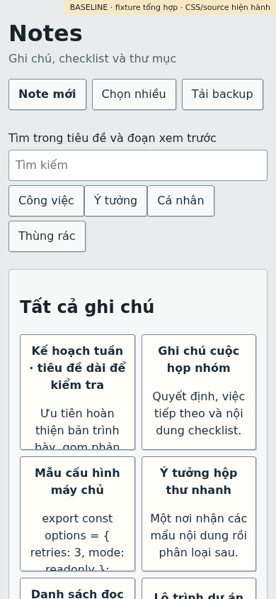 |
| iPad mini reference portrait, 744×1133 | 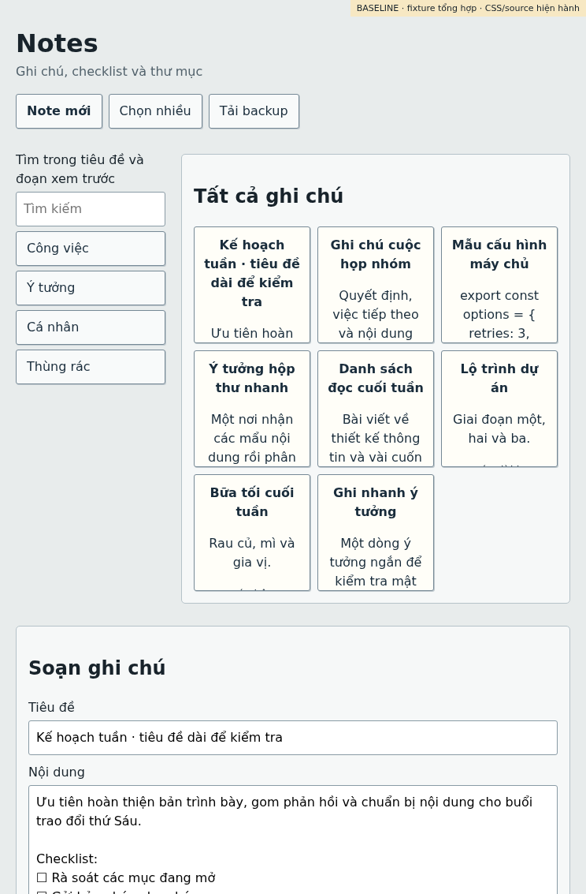 |
| iPad mini reference landscape, 1133×744 | 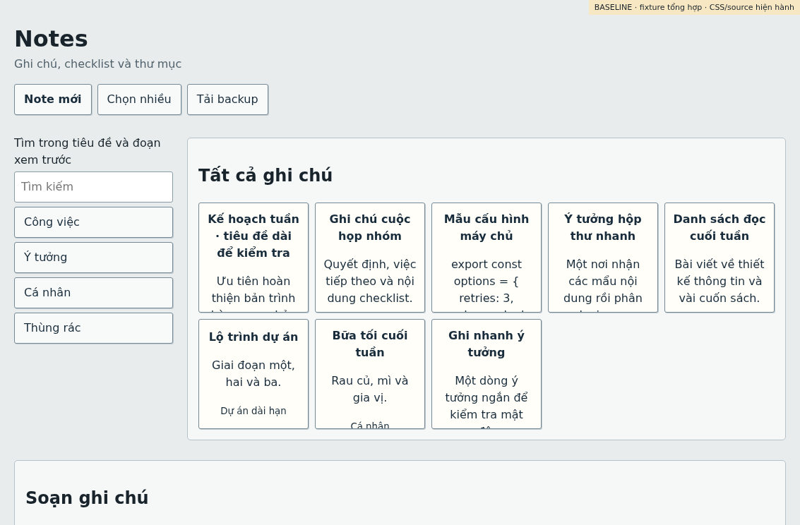 |
| PC, 1440×900 | 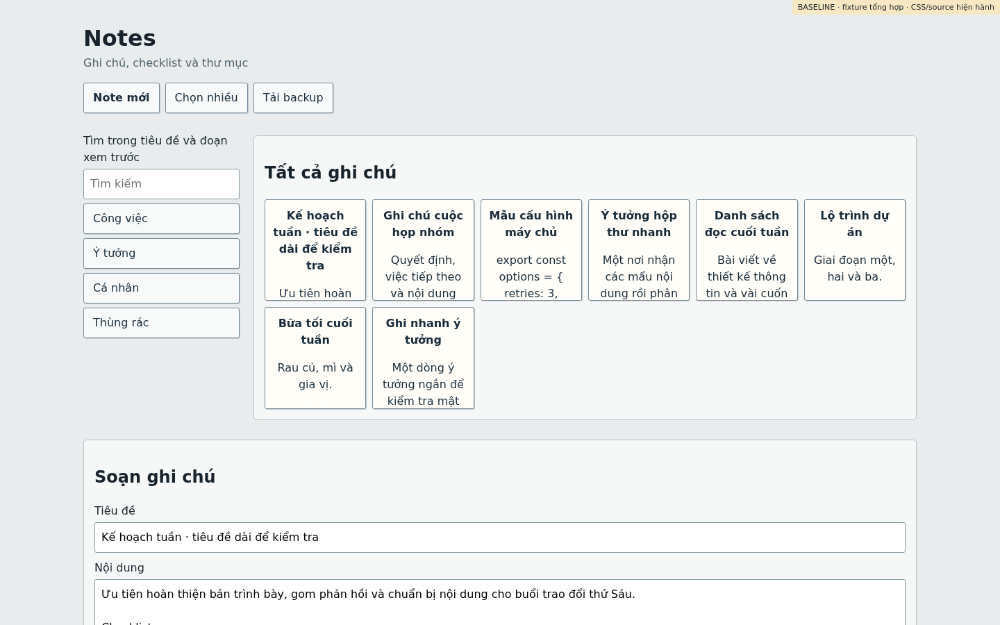 |

## Prototype layout

- **Phone (≤700 CSS px):** one primary surface. The list and editor have explicit navigation; folders open in a drawer; a bottom navigation bar provides Notes, Search, Trash, and Code Inbox. The editor reserves space above the bottom bar and updates its inset from `visualViewport` when the viewport changes. Title and body remain the same DOM controls during resize so draft text and caret do not jump.
- **iPad mini portrait (744×1133 reference):** compact 64px folder rail, 290px list, 390px editor. The two-pane editor is available at this width instead of forcing a list-only tablet page.
- **iPad mini landscape (1133×744 reference):** full 232px folder sidebar, 340px list, 561px editor.
- **PC (1440×900 tested, intended through 1920 CSS px):** full folder sidebar, fixed-width list, flexible editor. The editable text column is constrained by the editor content max-width plus side padding; code uses the full text area.

Common behaviors include a growing title field, search, note creation, folder movement, multi-select, trash/restore, history panel, sharing/revocation labels, checklist/code insertion, Code Inbox entry, and scenario controls for loading, empty, offline/draft-held, sync error, and conflict. Actions in this prototype are local demonstrations and do not implement production Firestore semantics.

Touch targets were checked at 40 CSS px or larger for visible buttons. Keyboard focus uses a visible outline; Ctrl/Cmd+K focuses search; Escape closes the folder drawer or returns to the list. Reduced-motion settings disable transitions. Selected muted text was darkened; the principal small-text color `#68746b` has a 4.88:1 contrast ratio against white. This is a targeted check, not a complete accessibility certification.

Prototype screenshots:

| Viewport | After |
| --- | --- |
| Phone list, 390×844 | 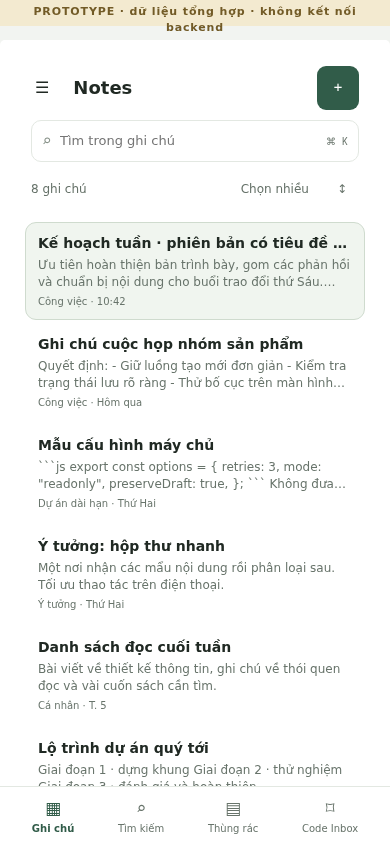 |
| Phone editor, 390×844 | 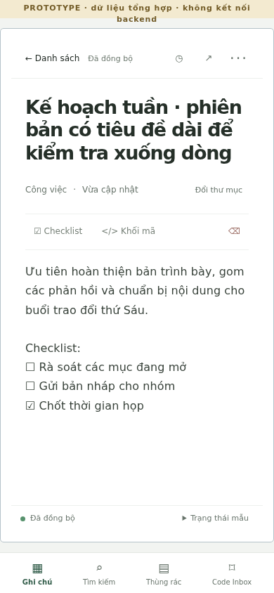 |
| Phone conflict fixture | 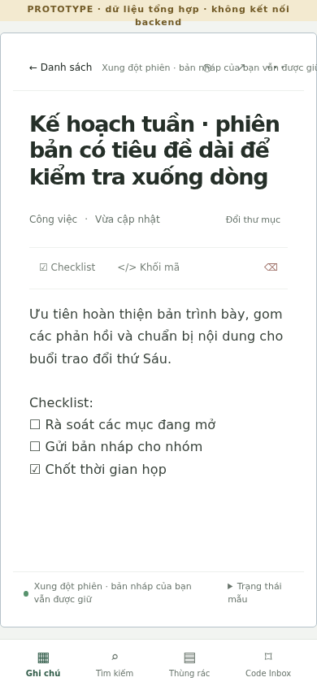 |
| Phone empty fixture | 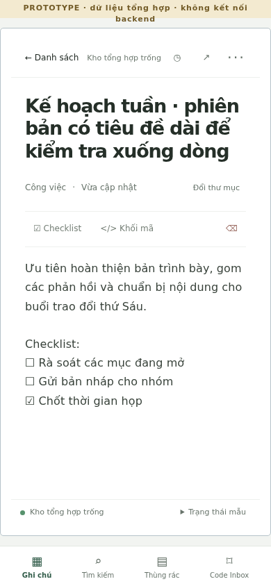 |
| iPad mini reference portrait, 744×1133 | 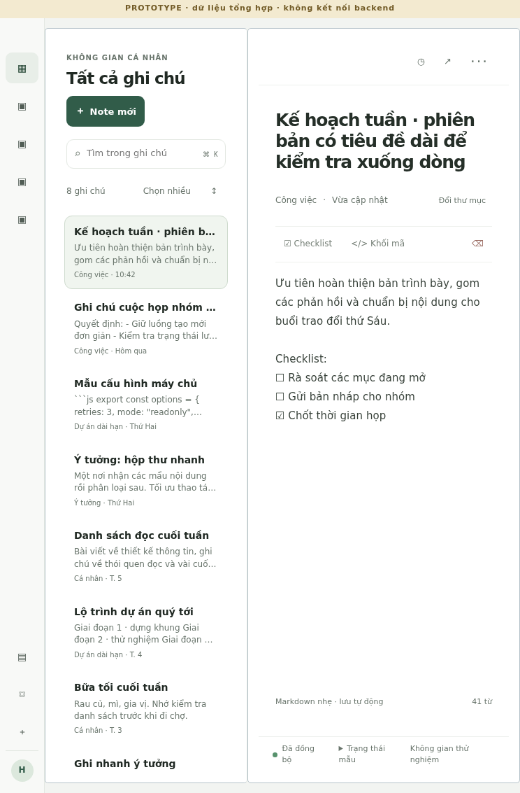 |
| iPad mini reference landscape, 1133×744 | 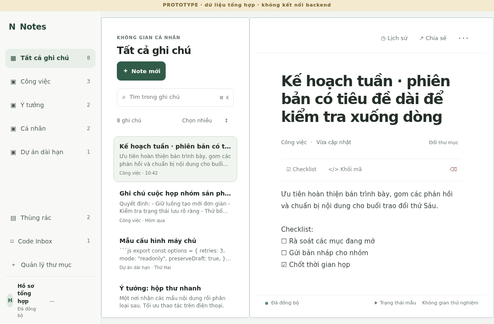 |
| PC, 1440×900 | 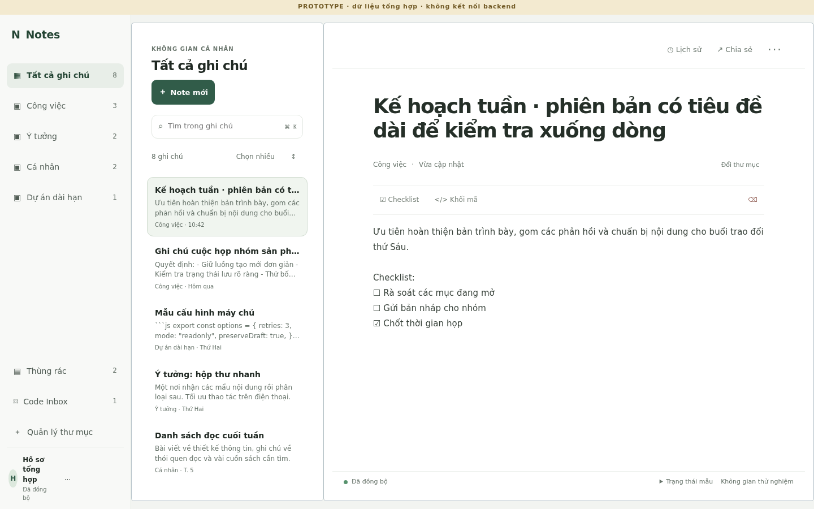 |

## Browser and source checks

Chromium headless ran the prototype at 390×844, 744×1133, 1133×744, and 1440×900. All four had no horizontal overflow; visible controls met the 40px check; the long title did not clip. The interaction smoke covered search/open, editing, local synthetic draft after reload, history, share/revoke, creation, resize with text and caret retained, keyboard search, drawer open, multi-select, trash/restore, empty/conflict states, focus indicator, and reduced motion. Per-viewport dimensions and checks are in `ui-prototype-20261029/browser-results.json`; the runner is `scripts/ui-prototype-smoke.mjs`.

- `npm run check:source` — PASS; 49 JavaScript modules syntax-checked/imported, no truncation markers.
- `npm test` — PASS; 191 tests, 0 failed.
- `node --check prototype/ui-responsive/prototype.js` and `node --check scripts/ui-prototype-smoke.mjs` — PASS.
- Chromium version was the NAS-installed arm64 headless shell invoked explicitly because the installed Playwright package expected a different cached browser revision.

No physical iPad mini 7, iPadOS Safari, S25 Ultra, or on-screen keyboard was available. The CSS viewport sizes are emulated in Chromium; this does not establish behavior on those devices. `visualViewport` inset handling is implemented but requires device acceptance with the keyboard open, Safari address bars changing, rotation, zoom, and safe areas. The baseline is a static reconstruction, not a live authenticated UI capture. ChatGPT and the user should review this prototype before any real application change or Production rollout.

## Gemini independent review

The existing NAS `gemini-task` text API wrapper returned a valid response in one call using default model `gemini-3.5-flash-lite`. The wrapper is text-only, so the review received the sanitized layout/CSS summary, viewport geometry, and interaction description in `ui-prototype-20261029/gemini-review-prompt.txt`; it did not receive image attachments, Notes, auth, or network data.

- **Accepted:** account for mobile keyboard/viewport occlusion; make the “held locally” state clearly distinct from sync; use plain language for share revocation. Prototype now reserves the bottom-navigation area, tracks `visualViewport` inset, labels draft “Đã giữ trên máy · chưa đồng bộ”, and labels share revocation “Ngừng chia sẻ”. Browser emulation verifies layout/behavior, but not real keyboard geometry.
- **Rejected after source/CSS check:** shrink the desktop text column to a 720px container. At 1440px, the current prototype editor content is capped at 860px with 76px side padding, leaving about 708px for text; the body has that constrained width while code blocks can use it. A tighter universal cap would not improve the checked layout and could unnecessarily constrain code.
- Gemini also noted that touch feel, low-end-device title resizing, and tablet visual hierarchy require device review. Those remain open acceptance items; the text-only review did not inspect screenshots.

## Open the prototype

From the repository root, serve the static repository on loopback and open `http://127.0.0.1:4173/prototype/ui-responsive/`. The prototype has no backend dependency. On the NAS, wrap the shell command as required by local operating procedure:

```sh
/home/admin/bin/copyout 'cd /vol1/Docker/.codex-admin/worktrees/web-notes-ui-prototype-20261029 && python3 -m http.server 4173 --bind 127.0.0.1'
```

The command is intended for a local NAS browser. Use a trusted local browser session or SSH tunnel if viewing from another device; do not expose it publicly.

## Review gate

This remains a prototype branch. No merge or Production deployment was performed. Review phone one-handed use, tablet portrait split width, landscape editor width, editor keyboard avoidance, and desktop code/text density before deciding whether to port any design to the real Firestore UI. Backend behavior and Production data were not exercised or modified.
